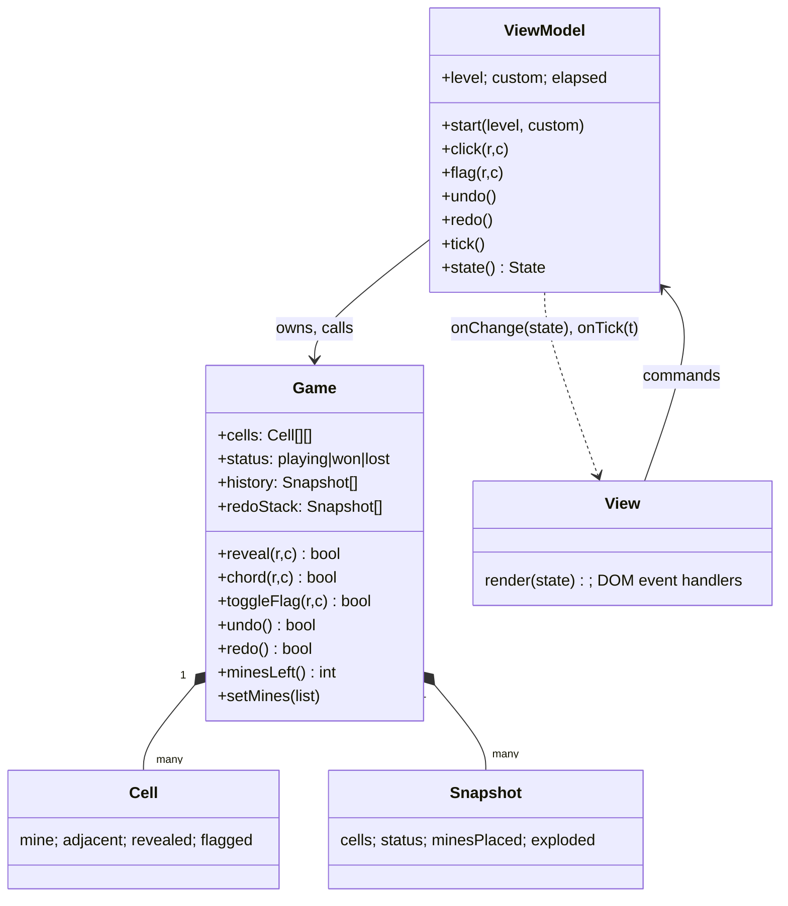

# Minesweeper with Full Undo

**Language: JavaScript (HTML/CSS/JS in a browser).** Zero install: open `index.html`. Tests use Node's built-in runner, so no packages at all.

## 1. Rules, assumptions, undo
- **Objective:** reveal every safe cell without revealing a mine.
- **Board:** difficulty dropdown: Beginner 9x9/10 mines (default), Intermediate 16x16/40, Expert 16x30/99. **Custom** lets you pick rows (5-30), columns (5-40) and mines (1 to cells-9, so the safe first-click area always fits); values are clamped. Changing it starts a new game. Custom games record no best time.
- **Clues:** a revealed number = mines among the 8 neighbours. Left-click reveals; left-clicking a revealed number whose flag count equals it **chords** (opens all its unflagged neighbours; a wrong flag can hit a mine and lose; one undo step).  right-click toggles a flag. The counter shows `mines - flags` (can go negative).
- **Mine placement:** on the first reveal, never on the clicked cell or its neighbours. The first click is always safe and always opens an area.
- **Win:** all safe cells revealed (mines are then auto-flagged). **Loss:** a mine is revealed; all mines are shown; further clicks are ignored.
- **Undo restores the exact previous state:** revealed cells, flags, mines, status, exploded cell. It works after a loss or a win.
- **Flood-fill:** revealing a 0 cell opens its neighbours repeatedly (iterative stack). The snapshot is taken once, *before* the click, so the whole cascade is one undo step.
- **Undoing the first move:** the snapshot predates mine placement, so undo returns to an empty, mine-less board. The next first click lays out *new* mines (still safe). Assumption: layout is not preserved.
- Clicks that change nothing (revealed/flagged cell, game over) are not recorded. Undo on empty history does nothing (button disabled). **Redo** re-applies undone moves (undo/redo stacks of snapshots); making a new move clears redo. **Timer** counts seconds while a game is in progress and stops on win/loss; undoing the first move resets it. **Best time** per difficulty is kept in the browser's `localStorage`. **Touch:** long-press (450 ms) a cell to flag it. **Keyboard:** defaults are arrows move a highlighted cursor, Enter/Space reveal or chord, F flags, C chords only (never reveals), M toggles mute, U undo, Y redo, N new game. Every action is **rebindable** in the page's Keys panel and can have **several keys**: click "+ add key" then press a key (Esc cancels), or click a key's ✕ to remove it (an action always keeps one). Shift/Ctrl/Alt/Meta/Esc/Tab and keys already in use are refused; Reset keys restores defaults. **Export / import:** the Settings panel exports difficulty, custom size, keys, mute and volume as JSON text and imports it back; an import is all-or-nothing (any invalid field rejects the whole thing). **Saved settings:** difficulty, custom size, key map, mute and volume persist in `localStorage`; corrupt saved data falls back to defaults. **Cell size** scales so the board fits the window (16-40 px). **Sound:** short Web Audio beeps for reveal, flag, undo, loss and win; each sound has its own relative volume, plus a master volume slider and a mute checkbox; mute and volume are saved in `localStorage` and restored next visit.

## 2. Design (MVVM)
| Part | File | Responsibility |
|---|---|---|
| Model: `Game` | `src/game.js` | All rules: cells, mines, numbers, reveal, chord, flood-fill, flags, win/loss, undo/redo snapshot stacks. No DOM. |
| Cell | plain object in `Game.cells` | `{mine, adjacent, revealed, flagged}` data only. |
| ViewModel | `src/viewmodel.js` | UI state and commands (also keyboard cursor and `cellSize`): difficulty/custom size (clamped), timer, best times (via injected storage), click-vs-chord choice. Exposes `state()`; no DOM. |
| View (plain JS) | `src/app.js` + `index.html` | Draws `vm.state()`, forwards clicks, right-clicks, long-presses, key presses and buttons to ViewModel commands. |
| View (Vue 3) | `src/vue-app.js` + `vue.html` | The same job done with Vue; reuses the unchanged Game and ViewModel. Loads Vue 3.5.13 from the cdnjs CDN (needs internet; no build step, no npm packages). |
| Sound | `src/sound.js` | Web Audio beeps shared by both views. |

Why two views: because the ViewModel owns all state, commands and key handling (`pressKey`), a framework view is only rendering and event wiring; the Vue view needed no changes to the model or ViewModel. The ViewModel is testable in plain Node. Both pages share saved settings (same `localStorage`).



## 3. Run it
Needs only a modern browser. Open `index.html` (double-click) for the plain version, or `vue.html` for the Vue version (internet needed for the Vue CDN script; if a browser blocks `file://` scripts, run `python3 -m http.server` in the folder and open `http://localhost:8000/vue.html`). Sources: `index.html`, `vue.html`, `style.css`, `src/game.js`, `src/viewmodel.js`, `src/sound.js`, `src/app.js`, `src/vue-app.js`.

## 4. Tests
Requires Node 18+. From the project folder:
```bash
node --test
```
37 tests (`game.test.js`, `viewmodel.test.js`): mine placement, numbers, flagging, flood-fill, win, loss, and undo of: first move, a large flood-fill, a flag, empty history, after a loss, after a win; plus redo (re-apply, cleared by a new move, empty stack, after a loss, first move); chord (opens neighbours, one undo step, no-op cases, wrong flag loses); ViewModel (custom clamping, presets, timer, best times, click-vs-chord, keyboard cursor, cell sizing, saved mute/volume, chord command, saved difficulty/custom size, key map rebinding, multiple keys, keyboard dispatch, settings export/import and corrupt-data fallback).

## 5. Report
**Game/rules/design:** see sections 1-2. **Implementation:** logic/UI separation; state changes happen only through `reveal`, `toggleFlag`, `undo`, `newGame`; the UI re-renders the whole grid after each action. **Undo design:** full-state snapshots (81 cells, cheap) chosen over storing diffs because they are impossible to get subtly wrong. **Testing:** 37/37 pass under `node --test`; the GUI was not automatically tested, only the logic. **Limitations:** the DOM view (rendering, long-press, sound) has no automated tests (keyboard, chord, saved settings, key rebinding, multiple keys and export/import were checked manually in a browser, in both the plain and Vue views; sound was never listened to); custom sizes are capped at 30x40; first-move undo re-randomises mines, history is unbounded (fine at this size).

## 6. Demo script
1. Open `index.html`. Note Mines: 10, Undo disabled.
2. Click the centre: opens a safe area (safe first click + flood-fill). Click Undo: board blank again (first-move undo).
3. Click again, then Undo; repeat to show a different layout each time.
4. Right-click a cell: flag, counter 9. Undo: flag gone, counter 10.
5. Reveal cells using the numbers, flagging suspects, until all safe cells are open: "You won!". Undo: back to playing.
6. New Game, click a few cells, then click a guessed cell until you hit a mine: all mines shown, "You lost". Undo: the board returns to just before the mistake.
7. Press Undo repeatedly until it greys out (empty history).

## 7. Git workflow
```bash
git init
git add package.json .gitignore && git commit -m "Project setup: package.json, folder layout"
git add src/game.js && git commit -m "Add Game class: board, mine placement, adjacent counts"
# (reveal, flood-fill, flags, win/loss live in game.js; commit them as separate steps with git add -p)
git add -p src/game.js && git commit -m "Add reveal, iterative flood-fill, flags, win/loss rules"
git add -p src/game.js && git commit -m "Add snapshot-based undo"
git add index.html src/app.js && git commit -m "Add browser GUI"
git add test && git commit -m "Add node:test suite"
git add README.md && git commit -m "Add report and demo plan"
```
(Because the files already exist, use `git add -p` to split `game.js` honestly across the logic/rules/undo commits, or merge those into one commit.)

## Optional enhancements still not implemented
- Bundle Vue locally (npm + a build step) so the Vue page works offline.
- Download/upload settings as a file instead of copy-paste text.
- A React version of the View.
