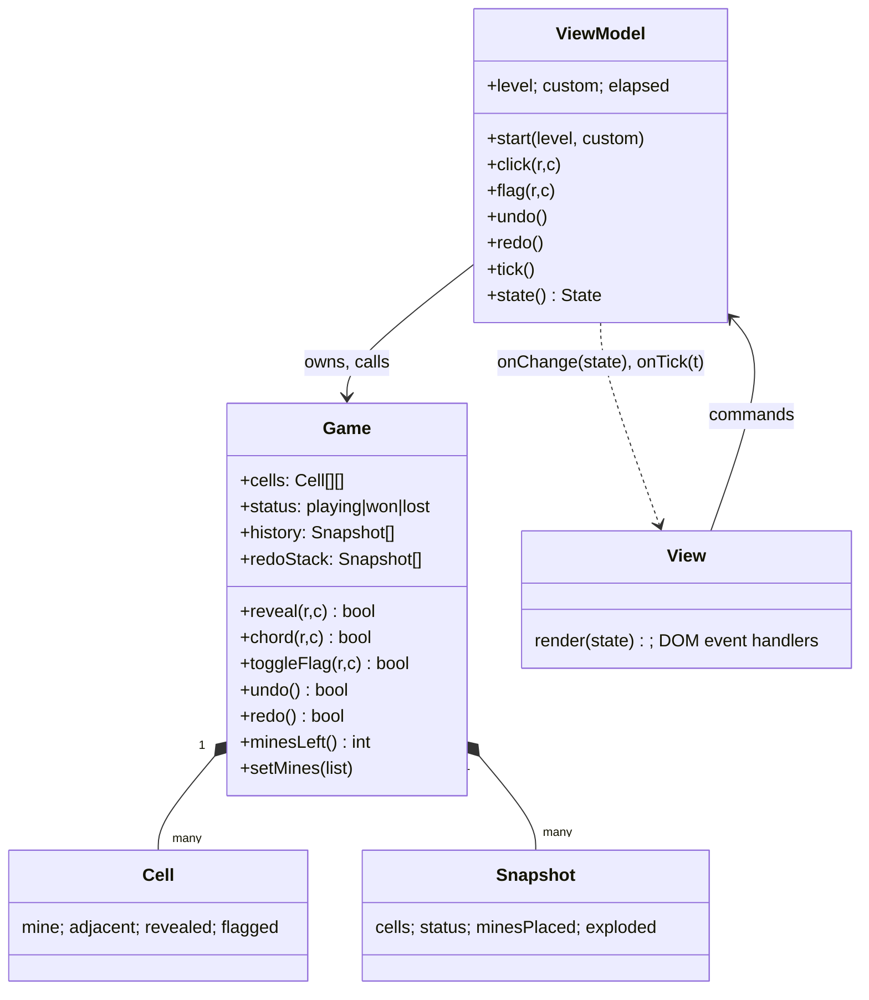

# Minesweeper with Full Undo

**Language: JavaScript (HTML/CSS/JS in a browser).** Zero install: open `index.html`. Tests use Node's built-in runner, so no packages at all.

## 1. Rules, assumptions, undo
- **Objective:** reveal every safe cell without revealing a mine.
- **Board:** difficulty dropdown: Beginner 9x9/10 mines (default), Intermediate 16x16/40, Expert 16x30/99. **Custom** lets you pick rows (5-30), columns (5-40) and mines (1 to cells-9, so the safe first-click area always fits); values are clamped. Changing it starts a new game. Custom games record no best time.
- **Clues:** a revealed number = mines among the 8 neighbours. Left-click reveals; left-clicking a revealed number whose flag count equals it **chords** (opens all its unflagged neighbours; a wrong flag can hit a mine and lose; one undo step).  right-click toggles a flag. The counter shows `mines - flags` (can go negative).
- **Mine placement:** on the first reveal, never on the clicked cell or its neighbours. The first click is always safe and always opens an area.
- **Win:** all safe cells revealed (mines are then auto-flagged). **Loss:** a mine is revealed; all mines are shown; further clicks are ignored.
- **Undo restores the exact previous state:** revealed cells, flags, mines, status, exploded cell. It works after a loss or a win.
- **Flood-fill:** revealing a 0 cell opens its neighbours repeatedly (iterative stack). The snapshot is taken once, *before* the click, so the whole cascade is one undo step.
- **Undoing the first move:** the snapshot predates mine placement, so undo returns to an empty, mine-less board. The next first click lays out *new* mines (still safe). Assumption: layout is not preserved.
- Clicks that change nothing (revealed/flagged cell, game over) are not recorded. Undo on empty history does nothing (button disabled). **Redo** re-applies undone moves (undo/redo stacks of snapshots); making a new move clears redo. **Timer** counts seconds while a game is in progress and stops on win/loss; undoing the first move resets it. **Best time** per difficulty is kept in the browser's `localStorage`. **Touch:** long-press (450 ms) a cell to flag it. **Keyboard:** defaults are arrows move a highlighted cursor, Enter/Space reveal or chord, F flags, C chords only (never reveals), M toggles mute, U undo, Y redo, N new game. Every action is **rebindable** in the page's Keys panel and can have **several keys**: click "+ add key" then press a key (Esc cancels), or click a key's ✕ to remove it (an action always keeps one). Shift/Ctrl/Alt/Meta/Esc/Tab and keys already in use are refused; Reset keys restores defaults. **Settings file:** the Files panel downloads difficulty, custom size, keys, mute and volume as `minesweeper-settings.json`. **Saved game:** a game in progress is autosaved after every move and resumes when you reopen the page (time included; finished or untouched games start fresh), and "Download game" saves it to `minesweeper-game.json`: board, flags, difficulty, elapsed time and the full undo/redo history (each board is one character per cell, so files stay small). One upload box takes either kind of file. Imports are all-or-nothing and checked hard, because a file is untrusted input: bad JSON, a file over 100 KB, wrong sizes or characters, a mine count or number that disagrees with the board, a board that does not match its difficulty, or a status that does not match the board are all rejected and nothing changes. A loaded finished game never records a best time. **`?seed=N`** in a page's URL makes the boards reproducible (used by the browser tests). **Saved-game slots:** three slots in the "Saved games and best times" panel (Save here / Load / Delete), each holding a full game with undo history, kept until overwritten or deleted and separate from the autosave. **Best times:** the five fastest wins per difficulty (Beginner, Intermediate, Expert; not Custom) are listed in a table and the fastest is shown as Best. A win is recorded only when a player move wins it, so undo/redo, loading a file or a slot never adds a time; a single best time saved by an older version becomes the first entry. **Phones:** the pages have a viewport tag, and the board scrolls inside itself when it is wider than the screen. **Saved settings:** difficulty, custom size, key map, mute and volume persist in `localStorage`; corrupt saved data falls back to defaults. **Cell size** scales so the board fits the window (16-40 px). **Sound:** short Web Audio beeps for reveal, flag, undo, loss and win; each sound has its own relative volume, plus a master volume slider and a mute checkbox; mute and volume are saved in `localStorage` and restored next visit.

## 2. Design (MVVM)
| Part | File | Responsibility |
|---|---|---|
| Model: `Game` | `src/game.js` | All rules: cells, mines, numbers, reveal, chord, flood-fill, flags, win/loss, undo/redo snapshot stacks. No DOM. |
| Cell | plain object in `Game.cells` | `{mine, adjacent, revealed, flagged}` data only. |
| ViewModel | `src/viewmodel.js` | UI state and commands (also keyboard cursor and `cellSize`): difficulty/custom size (clamped), timer, best times (via injected storage), click-vs-chord choice. Exposes `state()`; no DOM. |
| View (plain JS) | `src/app.js` + `index.html` | Draws `vm.state()`, forwards clicks, right-clicks, long-presses, key presses and buttons to ViewModel commands. Bundled to `dist/plain-app.js` (about 5 KB; it uses the shared `dist/core.js`). |
| View (Vue 3) | `src/vue-app.js` + `vue.html` | The same job done with Vue; reuses the unchanged Game and ViewModel. Bundled with Vue to `dist/vue-app.js` (works offline; shared code from `dist/core.js`). |
| View (React 18) | `src/react-app.jsx` + `react.html` | The same job again with React hooks (`useSyncExternalStore` subscribes to the ViewModel). Source is JSX, so it is bundled with React to `dist/react-app.js` (shared code from `dist/core.js`). |
| Sound, files, seeds | `src/sound.js`, `src/settingsfile.js`, `src/rng.js` | Web Audio beeps; file download/upload; seedable random numbers. Shared by all three views. |

Why three views: because the ViewModel owns all state, commands and key handling (`pressKey`), a framework view is only rendering and event wiring; neither the Vue nor the React view needed changes to the model or ViewModel. The ViewModel is testable in plain Node. Both pages share saved settings (same `localStorage`).



## 3. Run it
Needs only a modern browser, and works offline. Open `index.html` (plain JavaScript), `vue.html` (Vue) or `react.html` (React) by double-clicking; each page links to the others. If your browser blocks scripts on `file://` pages, run `npm run serve` (or `python3 -m http.server`) and open `http://127.0.0.1:4173/`.

**Build step (only needed after changing `src/` or upgrading a package).** Requires Node 18+ and npm:
```bash
npm install
npm run build
```
`scripts/build.js` uses esbuild to make four scripts in `dist/`: **`core.js`**, the game, ViewModel, sound and file code that all views share (one global, `MinesweeperCore`), and one small script per view (`plain-app.js`, `vue-app.js` with Vue, `react-app.js` with React). Each page loads `core.js` first, then its own script, so the game code is no longer copied into every bundle. In a view bundle, imports of the shared files are replaced by reads from `MinesweeperCore` (an esbuild plugin in `build.js`). Plain `<script>` tags are used instead of ES-module code splitting on purpose: browsers block module scripts on `file://` pages, which would break opening the pages by double-click. No CDN is used. The bundles are committed so the pages run without installing anything; `node_modules/` is not committed. `src/game.js`, `src/viewmodel.js` and `src/rng.js` stay plain CommonJS-compatible scripts so the Node tests can `require` them directly.

## 4. Tests
**Logic tests** (55; need only Node 18+, no install, Node's built-in runner):
```bash
node --test
```
They cover mine placement, numbers, flagging, flood-fill, win and loss, and undo of: the first move, a large flood-fill, a flag, empty history, after a loss, after a win; redo; chord; the ViewModel (custom clamping, presets, timer, best times, keyboard dispatch, multiple keys, settings and game export/import, corrupt-data fallback, autosave/resume, saved-game slots, best-times table); `Game.serialize/deserialize` including 13 kinds of tampered data; and seeded random numbers.

**Browser tests** (Playwright; 21 checks run against each of `index.html`, `vue.html` and `react.html`, in five projects: desktop Chrome, Firefox, WebKit (Safari's engine), a Pixel 7 phone (Android Chrome, touch) and an iPhone 14 (Safari, touch)):
```bash
npm install
npx playwright install               # once: downloads Chromium, Firefox and WebKit
npm run test:e2e                     # all projects
npm run test:e2e -- --project=webkit # just one
PW_CHANNEL=chrome npm run test:e2e   # use your own Chrome for the two Chromium projects instead of Playwright's
```
They start `scripts/serve.js` themselves and drive a real browser: safe first click and flood-fill, flags, undo/redo, loss, win, chord, keyboard play, key rebinding (saved across reload), saved difficulty and custom size, timer, saved mute/volume, settings download/upload (including bad and oversized files), autosave resume, game download/upload, rejecting a tampered game file, saved-game slots, the best-times table, board layout on a phone-sized screen (the board must not stick out past the screen edge, even on Expert), touch long-press to flag (and that the click after a long-press is ignored), and tap to reveal. Each page is opened with `?seed=11`; the test builds the same board with the `Game` model (same seed and first click give the same mines), so it knows where mines and numbers are. Deliberate bugs in `chord` and in the board's scrolling CSS made the matching tests fail, then the code was restored.

## 5. Report
**Game/rules/design:** see sections 1-2. **Implementation:** logic/UI separation; state changes happen only through `reveal`, `toggleFlag`, `undo`, `newGame`; the UI re-renders the whole grid after each action. **Undo design:** full-state snapshots (81 cells, cheap) chosen over storing diffs because they are impossible to get subtly wrong. **Testing:** 55/55 logic tests pass; browser tests pass in Chrome, WebKit, an Android phone profile and an iPhone profile (246 passed, 6 skipped: tap-to-reveal needs a touch screen). **Firefox is configured but was not run:** Firefox would not start inside this development sandbox ("Could not find profile folder"), so those results are unknown under `node --test`; the GUI was not automatically tested, only the logic. **Limitations:** the sound and the touch long-press (desktop Chrome only; sound was never listened to); phone results come from emulated devices (touch is simulated with pointer events; there was no real phone) has no automated tests (keyboard, chord, saved settings, key rebinding, multiple keys and export/import were checked manually in a browser, and are now covered by the browser tests in all three views; sound was never listened to); custom sizes are capped at 30x40; first-move undo re-randomises mines, history is unbounded (fine at this size).

## 6. Demo script
1. Open `index.html`. Note Mines: 10, Undo disabled.
2. Click the centre: opens a safe area (safe first click + flood-fill). Click Undo: board blank again (first-move undo).
3. Click again, then Undo; repeat to show a different layout each time.
4. Right-click a cell: flag, counter 9. Undo: flag gone, counter 10.
5. Reveal cells using the numbers, flagging suspects, until all safe cells are open: "You won!". Undo: back to playing.
6. New Game, click a few cells, then click a guessed cell until you hit a mine: all mines shown, "You lost". Undo: the board returns to just before the mistake.
7. Press Undo repeatedly until it greys out (empty history).

## 7. Git workflow
```bash
git init
git add package.json .gitignore && git commit -m "Project setup: package.json, folder layout"
git add src/game.js && git commit -m "Add Game class: board, mine placement, adjacent counts"
# (reveal, flood-fill, flags, win/loss live in game.js; commit them as separate steps with git add -p)
git add -p src/game.js && git commit -m "Add reveal, iterative flood-fill, flags, win/loss rules"
git add -p src/game.js && git commit -m "Add snapshot-based undo"
git add index.html src/app.js && git commit -m "Add browser GUI"
git add test && git commit -m "Add node:test suite"
git add README.md && git commit -m "Add report and demo plan"
```
(Because the files already exist, use `git add -p` to split `game.js` honestly across the logic/rules/undo commits, or merge those into one commit.)

## Optional enhancements still not implemented
- Run the Firefox project and confirm it passes (it needs a machine where Firefox can start).
- Test on a real phone; make cells on the Expert board bigger on phones (they stay 16 px, so the board scrolls sideways inside itself).
- Name your saved-game slots; more than three slots.
- Share Vue/React between pages (they still each bundle their own framework).
