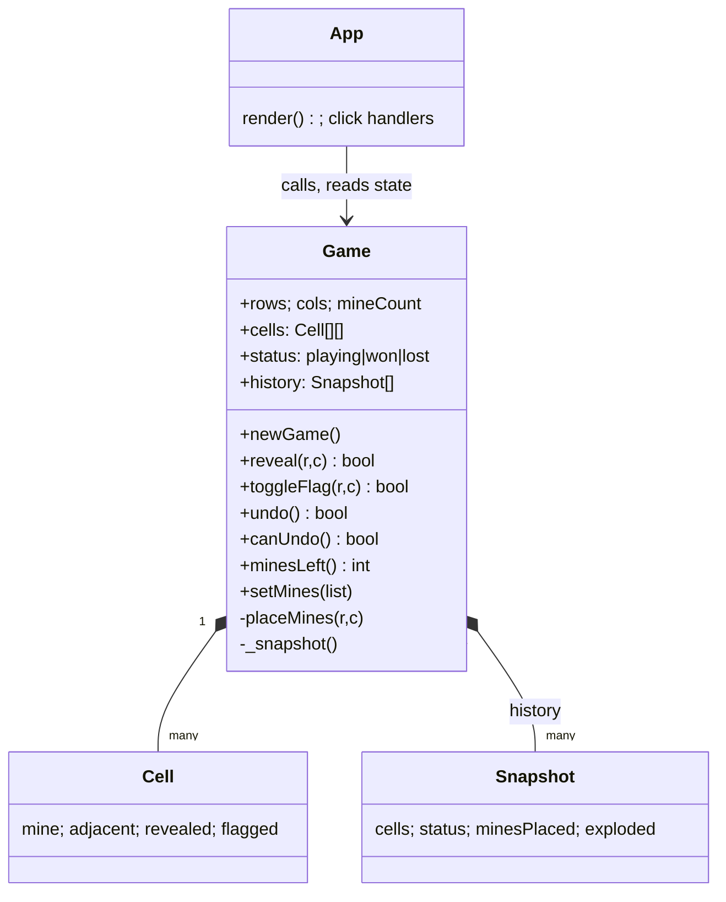

# Minesweeper with Full Undo

**Language: JavaScript (HTML/CSS/JS in a browser).** Zero install: open `index.html`. Tests use Node's built-in runner, so no packages at all.

## 1. Rules, assumptions, undo
- **Objective:** reveal every safe cell without revealing a mine.
- **Board:** 9x9, 10 mines (fixed "beginner" difficulty).
- **Clues:** a revealed number = mines among the 8 neighbours. Left-click reveals, right-click toggles a flag. The counter shows `mines - flags` (can go negative).
- **Mine placement:** on the first reveal, never on the clicked cell or its neighbours. The first click is always safe and always opens an area.
- **Win:** all safe cells revealed (mines are then auto-flagged). **Loss:** a mine is revealed; all mines are shown; further clicks are ignored.
- **Undo restores the exact previous state:** revealed cells, flags, mines, status, exploded cell. It works after a loss or a win.
- **Flood-fill:** revealing a 0 cell opens its neighbours repeatedly (iterative stack). The snapshot is taken once, *before* the click, so the whole cascade is one undo step.
- **Undoing the first move:** the snapshot predates mine placement, so undo returns to an empty, mine-less board. The next first click lays out *new* mines (still safe). Assumption: layout is not preserved.
- Clicks that change nothing (revealed/flagged cell, game over) are not recorded. Undo on empty history does nothing (button disabled). No redo.

## 2. Design
| Part | File | Responsibility |
|---|---|---|
| `Game` | `src/game.js` | Everything logical: cells, mines, numbers, reveal, flood-fill, flags, win/loss, undo stack (snapshots). No DOM. |
| Cell | plain object in `Game.cells` | `{mine, adjacent, revealed, flagged}` data only. |
| Snapshot / history | `Game.history` | Array of deep copies of cells + status; `undo()` pops one. |
| GUI controller | `src/app.js` | Maps clicks to `reveal/toggleFlag/undo/newGame`, then redraws from `Game` state. |

(Deliberately one logic class instead of separate Board/UndoManager classes: simpler for a student project; undo is ~6 lines.)



## 3. Run it
Needs only a modern browser. Open `index.html` (double-click). Sources: `index.html`, `src/game.js`, `src/app.js`.

## 4. Tests
Requires Node 18+. From the project folder:
```bash
node --test
```
13 tests: mine placement, numbers, flagging, flood-fill, win, loss, and undo of: first move, a large flood-fill, a flag, empty history, after a loss, after a win.

## 5. Report
**Game/rules/design:** see sections 1-2. **Implementation:** logic/UI separation; state changes happen only through `reveal`, `toggleFlag`, `undo`, `newGame`; the UI re-renders the whole grid after each action. **Undo design:** full-state snapshots (81 cells, cheap) chosen over storing diffs because they are impossible to get subtly wrong. **Testing:** 13/13 pass under `node --test`; the GUI was not automatically tested, only the logic. **Limitations:** fixed difficulty, no redo, no timer, no chord-click, no touch long-press for flags, first-move undo re-randomises mines, history is unbounded (fine at this size).

## 6. Demo script
1. Open `index.html`. Note Mines: 10, Undo disabled.
2. Click the centre: opens a safe area (safe first click + flood-fill). Click Undo: board blank again (first-move undo).
3. Click again, then Undo; repeat to show a different layout each time.
4. Right-click a cell: flag, counter 9. Undo: flag gone, counter 10.
5. Reveal cells using the numbers, flagging suspects, until all safe cells are open: "You won!". Undo: back to playing.
6. New Game, click a few cells, then click a guessed cell until you hit a mine: all mines shown, "You lost". Undo: the board returns to just before the mistake.
7. Press Undo repeatedly until it greys out (empty history).

## 7. Git workflow
```bash
git init
git add package.json .gitignore && git commit -m "Project setup: package.json, folder layout"
git add src/game.js && git commit -m "Add Game class: board, mine placement, adjacent counts"
# (reveal, flood-fill, flags, win/loss live in game.js; commit them as separate steps with git add -p)
git add -p src/game.js && git commit -m "Add reveal, iterative flood-fill, flags, win/loss rules"
git add -p src/game.js && git commit -m "Add snapshot-based undo"
git add index.html src/app.js && git commit -m "Add browser GUI"
git add test && git commit -m "Add node:test suite"
git add README.md && git commit -m "Add report and demo plan"
```
(Because the files already exist, use `git add -p` to split `game.js` honestly across the logic/rules/undo commits, or merge those into one commit.)

## Optional enhancements (not implemented)
- Difficulty presets (beginner/intermediate/expert).
- Timer and high-score storage in `localStorage`.
- Redo stack.
- Chord-click and long-press flagging for touch.
- MVVM/framework refactor.
