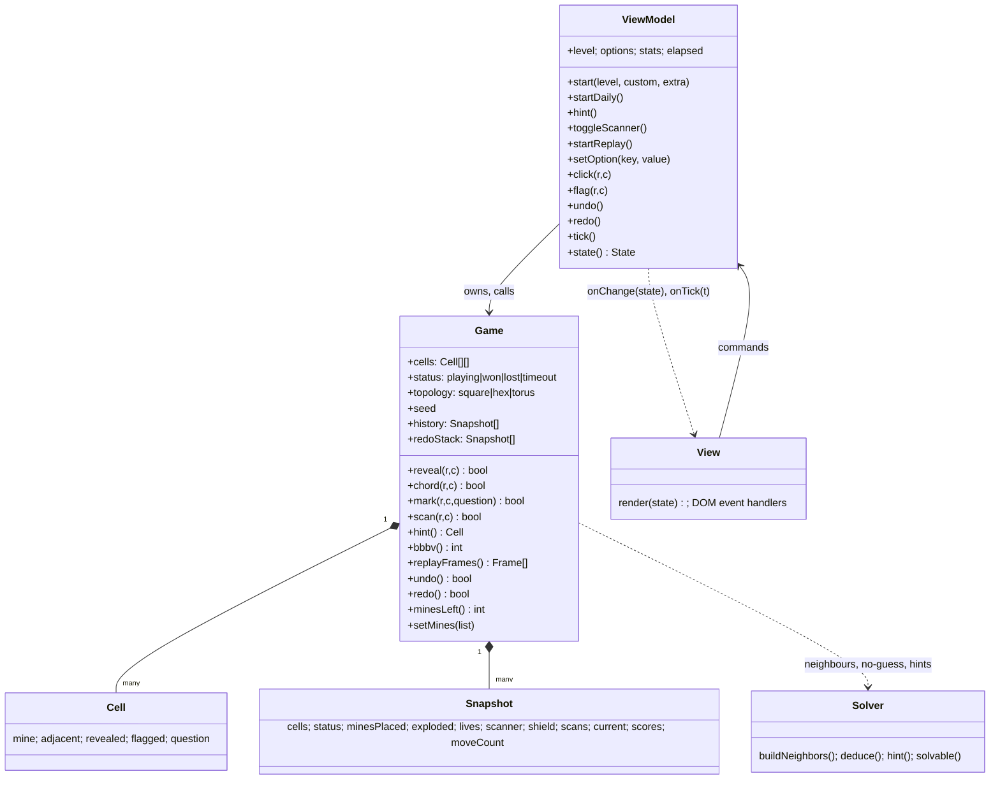

# Minesweeper with Full Undo

**Language: JavaScript (HTML/CSS/JS in a browser).** Zero install: open `index.html`. Tests use Node's built-in runner, so no packages at all.

## 1. Rules, assumptions, undo
- **Objective:** reveal every safe cell without revealing a mine.
- **Board:** difficulty dropdown: Beginner 9x9/10 mines (default), Intermediate 16x16/40, Expert 16x30/99. **Custom** lets you pick rows (5-30), columns (5-40) and mines (1 to cells-9, so the safe first-click area always fits); values are clamped. Changing it starts a new game. Custom games record no best time.
- **Clues:** a revealed number = mines among its neighbours (8 on square and wrap-around boards, 6 on hex). Left-click reveals; left-clicking a revealed number whose flag count equals it **chords** (opens all its unflagged neighbours; a wrong flag can hit a mine and lose; one undo step).  right-click toggles a flag. The counter shows `mines - flags` (can go negative).
- **Mine placement:** on the first reveal, never on the clicked cell or its neighbours. The first click is always safe and always opens an area. Every game has a **seed**: the cells are shuffled with that seed and the mines are the first ones outside the safe zone, so one seed gives (almost) one board whatever the first click is. That is what makes share links and the daily challenge possible.
- **Win:** all safe cells revealed (mines are then auto-flagged). **Loss:** a mine is revealed; all mines are shown; further clicks are ignored.
- **Undo restores the exact previous state:** revealed cells, flags, mines, status, exploded cell. It works after a loss or a win.
- **Flood-fill:** revealing a 0 cell opens its neighbours repeatedly (iterative stack). The snapshot is taken once, *before* the click, so the whole cascade is one undo step.
- **Undoing the first move:** the snapshot predates mine placement, so undo returns to an empty, mine-less board. The next first click lays out the mines again from the same seed (still safe), so redo and a second try give the same board unless you click somewhere else.
- Clicks that change nothing (revealed/flagged cell, game over) are not recorded. Undo on empty history does nothing (button disabled). **Redo** re-applies undone moves (undo/redo stacks of snapshots); making a new move clears redo. **Timer** counts seconds while a game is in progress and stops on win/loss; undoing the first move resets it. **Best time** per difficulty is kept in the browser's `localStorage`. **Touch:** long-press (450 ms) a cell to flag it. **Keyboard:** defaults are arrows move a highlighted cursor, Enter/Space reveal or chord, F flags, C chords only (never reveals), M toggles mute, U undo, Y redo, N new game. Every action is **rebindable** in Settings → Controls and can have **several keys**: click "+ add key" then press a key (Esc cancels), or click a key's ✕ to remove it (an action always keeps one). Shift/Ctrl/Alt/Meta/Esc/Tab and keys already in use are refused; Reset keys restores defaults. **Settings file:** Settings → Data downloads difficulty, custom size, keys, mute and volume as `minesweeper-settings.json`. **Saved game:** a game in progress is autosaved after every move and resumes when you reopen the page (time included; finished or untouched games start fresh), and "Download game" saves it to `minesweeper-game.json`: board, flags, difficulty, elapsed time and the full undo/redo history (each board is one character per cell, so files stay small). One upload box takes either kind of file. Imports are all-or-nothing and checked hard, because a file is untrusted input: bad JSON, a file over 100 KB, wrong sizes or characters, a mine count or number that disagrees with the board, a board that does not match its difficulty, or a status that does not match the board are all rejected and nothing changes. A loaded finished game never records a best time. **`?seed=N`** in a page's URL makes the boards reproducible (used by the browser tests). **Saved-game slots:** three slots in the "Saved games and best times" panel (Save here / Load / Delete), each holding a full game with undo history, kept until overwritten or deleted and separate from the autosave. **Best times:** the five fastest wins per difficulty (Beginner, Intermediate, Expert; not Custom) are listed in a table and the fastest is shown as Best. A win is recorded only when a player move wins it, so undo/redo, loading a file or a slot never adds a time; a single best time saved by an older version becomes the first entry. **Phones:** the pages have a viewport tag, and the board scrolls inside itself when it is wider than the screen. **Saved settings:** difficulty, custom size, key map, mute and volume persist in `localStorage`; corrupt saved data falls back to defaults. **Cell size** scales so the board fits the window (16-40 px). **Sound:** short Web Audio beeps for reveal, flag, undo, loss and win; each sound has its own relative volume, plus a master volume slider and a mute checkbox; mute and volume are saved in `localStorage` and restored next visit.

### Extended features
All of these are on by default or in the **New game…** menu and Settings (*applies to the next new game* unless marked "now"), and every one works in all three views. The rules live in `Game` (`src/game.js`) and `src/solver.js`; modes, statistics and badges live in the ViewModel.

| # | Feature | How it works |
|---|---|---|
| 1 | Question marks | Right-click cycles hidden, flag, `?`, hidden. A `?` is not a flag (it does not change the mine counter or a chord). Option *Question marks* (now). |
| 2 | Power-ups | Option *Power-ups*: 3 scanners and 1 shield per game. Scanner: press the button (key `S`), click a cell, and it shows how many mines are in that cell plus its neighbours (the 3x3 area; 7 cells on hex). The shield absorbs the first mine you open (the mine stays hidden, marked with a flag). Both are undoable. |
| 3 | Hint | Button / key `H`: outlines one cell that is *certainly* safe, worked out only from the open numbers (single-number rules plus the subset rule). If nothing is certain it says you must guess. Using a hint removes the game from the best-times table. |
| 4 | Neighbour highlight | Hover an open number: its neighbours are outlined and a line says how many more flags it needs (or how many too many). |
| 5 | Dimmed numbers | A number whose neighbouring flags equal it is dimmed. Option *Dim finished numbers* (now). |
| 6 | Lives | Mode *Lives (3)*: a mine costs a life (the mine stays shown); the third ends the game. Undo gives a life back. |
| 7 | Limited undo | Mode *Limited undo (3)*: only 3 undos (redo is free). Mode *Undo costs 10 s*: each undo adds 10 seconds to the clock. |
| 8 | No-guess boards | Option *No-guess boards*: after your first click the game tries random boards until a logic-only solver can finish it without guessing (usually instant; if it cannot find one in 3 s it says so). They cannot be shared as links. |
| 9 | Time attack | Mode *Time attack*: a countdown of 1.5 s per cell (122 s on Beginner); at 0 the game is lost and undo is off. |
| 10 | Zen | Mode *Zen*: no clock and nothing recorded in best times or 3BV/s (the game still counts as played/won). |
| 11 | Two players | Mode *Two players (hot-seat)*: players alternate reveals (flags and scans do not pass the turn), each scores the cells they opened, and whoever opens a mine loses; if the board is cleared the higher score wins. |
| 12 | Hex board | Option *Board: Hexagonal*: pointy-top hexagons, 6 neighbours, odd rows shifted half a cell. |
| 13 | Wrap-around | Option *Board: Wrap-around*: a torus, so the edges connect (every cell has 8 neighbours). |
| 14 | Daily challenge | "Start today's daily challenge": a seed from today's UTC date, Intermediate, classic rules, so everyone gets the same board. Has its own badge. |
| 15 | Share link | The link shown under "Daily challenge and sharing" (`?play=ROWSxCOLSxMINES-SHAPE-SEED`) reproduces a board. It is validated; a bad link is ignored. |
| 16 | Statistics | Games played, wins, losses, win rate, current and best win streak, and the 3BV and 3BV/s of games (3BV = the fewest clicks that could solve the board). A game's result is counted once, when it first ends; two-player games are counted separately; reset button included. |
| 17 | Replay | After a game ends, "Replay" steps through it move by move (or auto-plays one move per second), read-only. It replays the moves still in effect (undone moves are not shown). |
| 18 | Achievements | 14 badges, e.g. *No take-backs* (win Expert without undo), *Pure logic* (win a no-guess board without a hint), *Survivor* (win Lives mode with one life left), *Hex explorer*, *Daily winner*. Unlocked badges are saved and announced in the status line. |
| 19 | Themes | Option *Theme* (now): light, dark, and a colour-blind palette (Okabe-Ito colours, higher numbers also underlined). |

Best times are recorded only for comparable games: classic mode, square board, no power-ups, no hints, not Custom. Uploaded game files never add a result.

### The interface
| # | What | How it works |
|---|---|---|
| 1 | Board first | The board sits at the top, centred in a card. Statistics, saved games, best times and the share link are in a side panel beside it. |
| 2 | Game header | Mine counter on the left, the face button (new game: 🙂, 😎 after a win, 😵 after a loss) in the middle, timer on the right. |
| 3 | Grouped controls | Undo, Redo, Hint, Flag mode and New game… are always there; Scanner (power-ups on) and Replay (game finished) appear only when they apply. |
| 4 | New game menu | One popover holds Difficulty, Custom size, mode, board, no-guess, power-ups, "Start new game" and the daily challenge. |
| 5 | Side panel / bottom sheet | Beside the board on wide screens; on phones it slides up from the bottom ("Stats & saves"). |
| 6 | 3D cells | Hidden cells are raised (light top-left edge, dark bottom-right); open cells are flat and inset. |
| 7 | LCD counters | Mines and time use monospace digits on a dark LCD background. |
| 8 | Modern styling | System font stack, rounded corners, one accent colour from the theme variables (`style.css`). |
| 9 | Auto theme | The default theme follows `prefers-color-scheme`; the selector is in the header (Auto, Light, Dark, Colour-blind). |
| 10 | Clear loss | The mine you hit is outlined, wrong flags get a red cross, everything else is dimmed, and all mines show. |
| 11 | Animations | Opened cells pop (a flood-fill ripples outward from the click), flags bounce. |
| 12 | Result overlay | Win, loss or time-out shows the outcome, your time and best time, and New game / Undo / Replay / Close buttons. |
| 13 | Blocked-move feedback | A move that is not allowed (a flagged cell, a number without matching flags, a finished game) shakes that cell; Undo/Redo/Hint with nothing to do flash the status line. |
| 14 | Reduced motion | `prefers-reduced-motion: reduce` turns every animation and transition off. |
| 15 | Flag mode | A toggle button: plain taps flag (and cycle to `?`) instead of opening cells. Taps on open numbers still chord. |
| 16 | Touch cells | On touch screens cells are at least 32 px; a bigger board (Expert) scrolls inside itself and can be pinch-zoomed. |
| 17 | Tap targets | Buttons and inputs are at least 44 px tall on touch screens and narrow windows. |
| 18 | First-time tips | One-time tips for right-click/long-press flagging and for chording; each disappears when dismissed or used, and Settings → Controls can show them again. |
| 19 | Shortcut help | The **?** button opens a dialog listing the current key bindings and the mouse/touch controls. |
| 20 | Cell labels | Each cell has an `aria-label` such as "Row 3, column 4, flagged" or "Row 2, column 2, 3 mines nearby". |
| 21 | Live status | The status line is `role="status"` with `aria-live="polite"`, so wins, losses and hints ("Hint: row 3, column 4 is certainly safe.") are announced. |
| 22 | Grid semantics | `role="grid"` with rows and grid cells; one tab stop (roving `tabindex`); arrow keys move the cursor and the keyboard focus together. |
| 23 | Focus and contrast | A 3 px focus ring on every control and cell. `test/contrast.test.js` checks WCAG contrast (4.5:1 for the numbers on open cells, 7:1 for body text, 3:1 for outlines) in Light, Dark, Colour-blind and Auto-on-a-dark-device. |
| 24 | Settings dialog | Tabs for Game, Controls, Appearance and Data (arrow keys move between tabs) instead of collapsible panels. |
| 25 | Descriptions | A short note under each option, and under each mode and board choice (it follows the selection). |
| 26 | Remembered tab | Settings reopens on the tab you used last. |
| 27 | Partial updates | The board's cells are created once; a move updates only the cells whose look changed (the ViewModel hands back the identical cell object for unchanged cells, and each view skips them). |

Shortcut keys and the Enter/Space rule: Enter and Space on a focused button press that button; on the board (or with nothing focused) they open the cursor cell. Game shortcuts are ignored while typing, or while a dialog or menu is open.

## 2. Design (MVVM)
| Part | File | Responsibility |
|---|---|---|
| Model: `Game` | `src/game.js` | All rules: cells, seeded mines, numbers, reveal, chord, flood-fill, flags and `?`, power-ups, lives, undo limit, two players, board shapes, win/loss/time-out, 3BV, replay frames, undo/redo snapshot stacks, save/load. No DOM. |
| Solver | `src/solver.js` | Neighbour lists for the three board shapes; a logic solver used for hints and no-guess boards. |
| Cell | plain object in `Game.cells` | `{mine, adjacent, revealed, flagged, question}` data only. |
| ViewModel | `src/viewmodel.js` | Everything about the session that is not a board rule: difficulty, game modes and clocks, options, hints and the scanner button, statistics, badges, best times, slots, replay, daily/share, key bindings, sound and theme settings (via injected storage). It even works out what each cell shows (`state().grid`), so every view draws the same. Exposes `state()`; no DOM. |
| View (plain JS) | `src/app.js` + `index.html` | Draws `vm.state()`, forwards clicks, right-clicks, long-presses, key presses and buttons to ViewModel commands. Bundled to `dist/plain-app.js` (about 5 KB; it uses the shared `dist/core.js`). |
| View (Vue 3) | `src/vue-app.js` + `vue.html` | The same job done with Vue; reuses the unchanged Game and ViewModel. Bundled with Vue to `dist/vue-app.js` (works offline; shared code from `dist/core.js`). |
| View (React 18) | `src/react-app.jsx` + `react.html` | The same job again with React hooks (`useSyncExternalStore` subscribes to the ViewModel). Source is JSX, so it is bundled with React to `dist/react-app.js` (shared code from `dist/core.js`). |
| Sound, files, seeds | `src/sound.js`, `src/settingsfile.js`, `src/rng.js` | Web Audio beeps; file download/upload; seedable random numbers, the daily seed, and share-link parsing. Shared by all three views. |

Why three views: because the ViewModel owns all state, commands and key handling (`pressKey`), a framework view is only rendering and event wiring; neither the Vue nor the React view needed changes to the model or ViewModel. The ViewModel is testable in plain Node. Both pages share saved settings (same `localStorage`).



## 3. Run it
Needs only a modern browser, and works offline. Open `index.html` (plain JavaScript), `vue.html` (Vue) or `react.html` (React) by double-clicking; each page links to the others. If your browser blocks scripts on `file://` pages, run `npm run serve` (or `python3 -m http.server`) and open `http://127.0.0.1:4173/`.

**Build step (only needed after changing `src/` or upgrading a package).** Requires Node 18+ and npm:
```bash
npm install
npm run build
```
`scripts/build.js` uses esbuild to make four scripts in `dist/`: **`core.js`**, the game, ViewModel, sound and file code that all views share (one global, `MinesweeperCore`), and one small script per view (`plain-app.js`, `vue-app.js` with Vue, `react-app.js` with React). Each page loads `core.js` first, then its own script, so the game code is no longer copied into every bundle. In a view bundle, imports of the shared files are replaced by reads from `MinesweeperCore` (an esbuild plugin in `build.js`). Plain `<script>` tags are used instead of ES-module code splitting on purpose: browsers block module scripts on `file://` pages, which would break opening the pages by double-click. No CDN is used. The bundles are committed so the pages run without installing anything; `node_modules/` is not committed. `src/game.js`, `src/viewmodel.js` and `src/rng.js` stay plain CommonJS-compatible scripts so the Node tests can `require` them directly.

## 4. Tests
**Logic tests** (125; need only Node 18+, no install, Node's built-in runner):
```bash
node --test
```
They cover mine placement, numbers, flagging, flood-fill, win and loss, and undo of: the first move, a large flood-fill, a flag, empty history, after a loss, after a win; redo; chord; the ViewModel (custom clamping, presets, timer, best times, keyboard dispatch, multiple keys, settings and game export/import, corrupt-data fallback, autosave/resume, saved-game slots, best-times table); `Game.serialize/deserialize` including many kinds of tampered data and old save formats; and seeded random numbers. `test/contrast.test.js` checks the colours in `style.css`. The newer tests (`test/game-modes.test.js`, `test/viewmodel-modes.test.js`, `test/viewmodel-ui.test.js`) cover each extended feature: `?` marks, scanner and shield, lives, undo limit and penalty, time attack and time-out, zen, two players, hex and wrap-around neighbours and flood-fill, seeds, hints (never on a mine over 150 random boards), no-guess boards finished using hints alone on every shape and size, 3BV, replay frames ending exactly where the game ended, statistics counted once per game, badge rules, the daily seed, share-link validation, and options.

**Browser tests** (Playwright; 57 checks run against each of `index.html`, `vue.html` and `react.html`, in five projects: desktop Chrome, Firefox, WebKit (Safari's engine), a Pixel 7 phone (Android Chrome, touch) and an iPhone 14 (Safari, touch)):
```bash
npm install
npx playwright install               # once: downloads Chromium, Firefox and WebKit
npm run test:e2e                     # all projects
npm run test:e2e -- --project=webkit # just one
PW_CHANNEL=chrome npm run test:e2e   # use your own Chrome for the two Chromium projects instead of Playwright's
```
They start `scripts/serve.js` themselves and drive a real browser: safe first click and flood-fill, flags, undo/redo, loss, win, chord, keyboard play, key rebinding (saved across reload), saved difficulty and custom size, timer, saved mute/volume, settings download/upload (including bad and oversized files), autosave resume, game download/upload, rejecting a tampered game file, saved-game slots, the best-times table, board layout on a phone-sized screen (the board must not stick out past the screen edge, even on Expert), touch long-press to flag (and that the click after a long-press is ignored), tap to reveal, and the extended features: the `?` cycle, hints, hover help, dimmed numbers, options, lives, power-ups, two players, zen / time attack / limited undo, hex and wrap-around boards (with the numbers on screen checked against neighbours worked out independently of the game code), no-guess boards finished by following hints, the daily challenge, share links, statistics and badges, replay, themes, and the redesign (layout on desktop and as a phone bottom sheet, the New game menu, 3D cells and LCD counters, the loss display, the result overlay, blocked-move feedback, animations and reduced motion, flag mode, touch sizes, tips, the help dialog, accessibility labels and arrow-key focus, Settings tabs, option descriptions, and partial board updates checked with a MutationObserver). Each page is opened with `?seed=11`; the test builds the same board with the `Game` model (same seed and first click give the same mines), so it knows where mines and numbers are. Deliberate bugs in `chord`, in the board's scrolling CSS, in the hex and wrap-around neighbour rules, in number dimming, in board rebuilding, in reduced motion and in arrow-key focus made the matching tests fail, then the code was restored.

## 5. Report
**Game, rules and design:** see sections 1-2. **Implementation:** the rules are in `Game` (no DOM); everything else about a session is in the ViewModel; three thin views (plain JavaScript, Vue, React) draw the same `state()`. **Undo design:** full-state snapshots (a board is one character per cell) chosen over diffs because they are impossible to get subtly wrong. **Testing:** 125 logic tests pass (including the contrast checks). Browser tests pass in desktop Chrome, WebKit, an Android phone profile and an iPhone profile (4 projects x 171 tests; 678 passed, 6 skipped because tap-to-reveal needs a touch screen). **Firefox is configured but was not run:** it would not start inside this development sandbox ("Could not find profile folder"), so those results are unknown.

**Limitations:** the sound has no automated test and was never listened to; touch is simulated with pointer events on emulated phones (no real phone was used); on a phone the toolbar wraps onto several rows, so the board starts lower than on a desktop; Expert on a phone scrolls sideways inside the board; hints use only single-number and subset logic; two-player is hot-seat only; custom sizes are capped at 30x40; the autosave stores the whole undo history (fine at this size).

## 6. Demo script
1. Open `index.html`. Note Mines: 10, Undo disabled.
2. Click the centre: opens a safe area (safe first click + flood-fill). Click Undo: board blank again (first-move undo).
3. Click again, then Undo; repeat to show a different layout each time.
4. Right-click a cell: flag, counter 9. Undo: flag gone, counter 10.
5. Reveal cells using the numbers, flagging suspects, until all safe cells are open: "You won!". Undo: back to playing.
6. New Game, click a few cells, then click a guessed cell until you hit a mine: all mines shown, "You lost". Undo: the board returns to just before the mistake.
7. Press Undo repeatedly until it greys out (empty history).

## 7. Git workflow
```bash
git init
git add package.json .gitignore && git commit -m "Project setup: package.json, folder layout"
git add src/game.js && git commit -m "Add Game class: board, mine placement, adjacent counts"
# (reveal, flood-fill, flags, win/loss live in game.js; commit them as separate steps with git add -p)
git add -p src/game.js && git commit -m "Add reveal, iterative flood-fill, flags, win/loss rules"
git add -p src/game.js && git commit -m "Add snapshot-based undo"
git add index.html src/app.js && git commit -m "Add browser GUI"
git add test && git commit -m "Add node:test suite"
git add README.md && git commit -m "Add report and demo plan"
```
(Because the files already exist, use `git add -p` to split `game.js` honestly across the logic/rules/undo commits, or merge those into one commit.)

## Not done
- Run the Firefox project and confirm it passes (it needs a machine where Firefox can start).
- Test on a real phone; make cells on the Expert board bigger on phones (they stay 16 px, so the board scrolls sideways inside itself).
- Two-player over the network (it is hot-seat only); no AI opponent.
- No-guess boards are built after the first click, so they cannot be shared as links or used for the daily challenge.
- Hints use only single-number and subset logic; a board that needs deeper reasoning (or a global mine count) reports "no certain move" even if one exists. The solver and the no-guess generator use the same rules, so a no-guess board is always finishable by hints.
- Name your saved-game slots; more than three slots; sound has no volume-per-effect UI.
