# Minesweeper with undo: project report

A browser Minesweeper written in plain HTML, CSS and JavaScript (no framework, no build step, no packages). Undo is a full undo: it restores the exact earlier state, including flags, opened cells, lives and the game status. See README.md for how to run it and its tests.

## 1. Screenshots

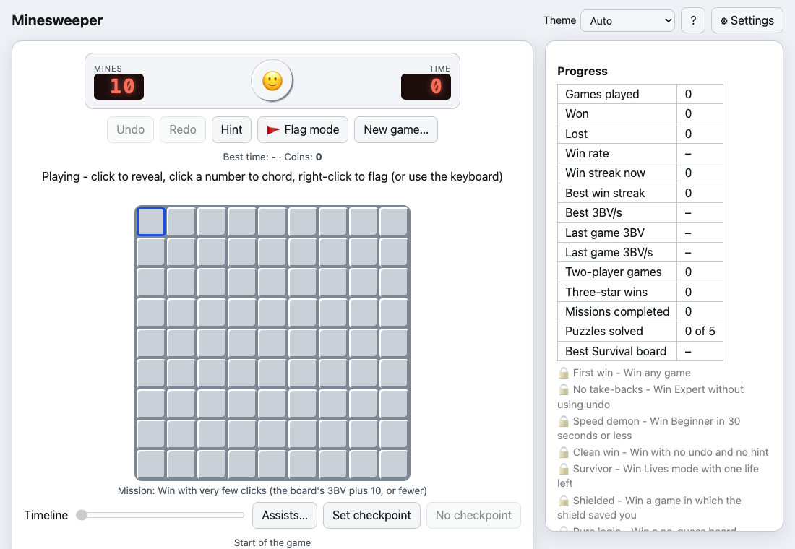

A new game: mine counter, face button and timer in the header, the board in a card, statistics and saved games in the side panel.

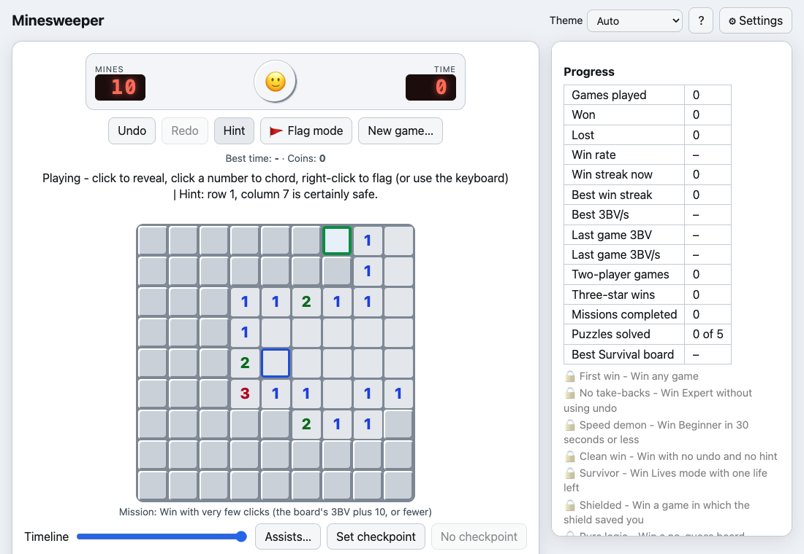

The first click is always safe and opens an area (flood-fill). The Hint button outlines a cell that is certainly safe (green).

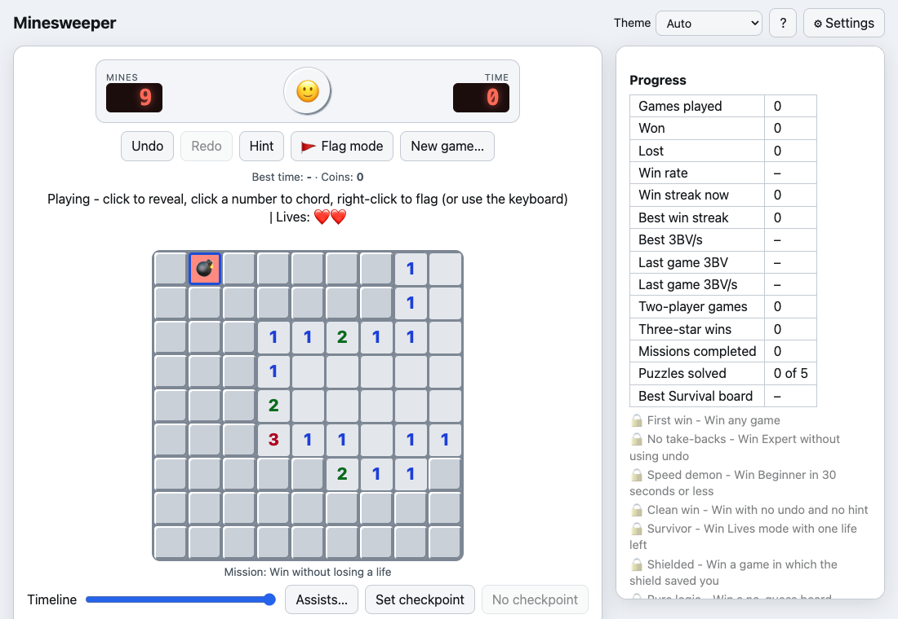

Lives mode: a mine costs a heart instead of ending the game.

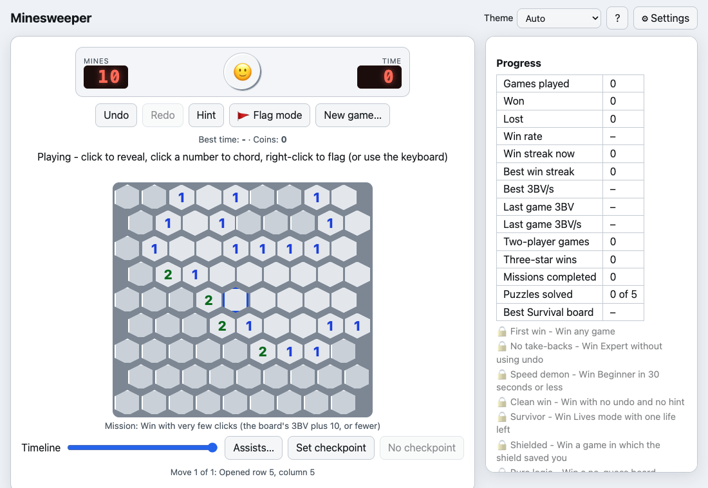

The hexagonal board: six neighbours per cell, so the numbers count differently.

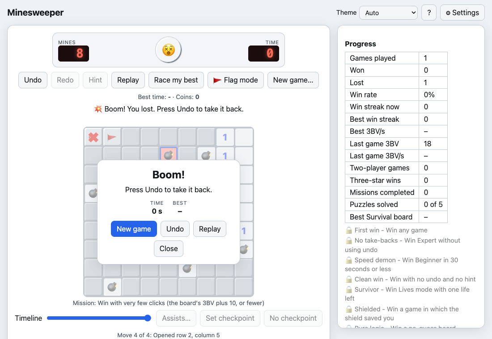

A loss: the mine that was hit is outlined, the wrong flag has a cross, everything else is dimmed, and the overlay offers New game, Undo and Replay.

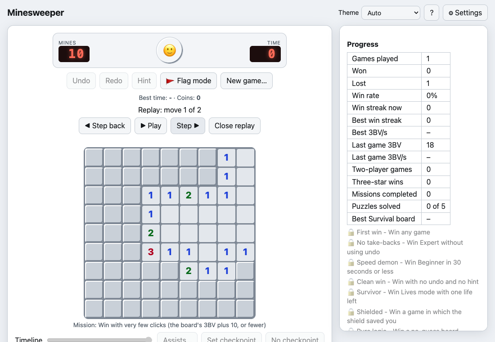

Replay: the finished game is stepped through move by move (or played automatically).

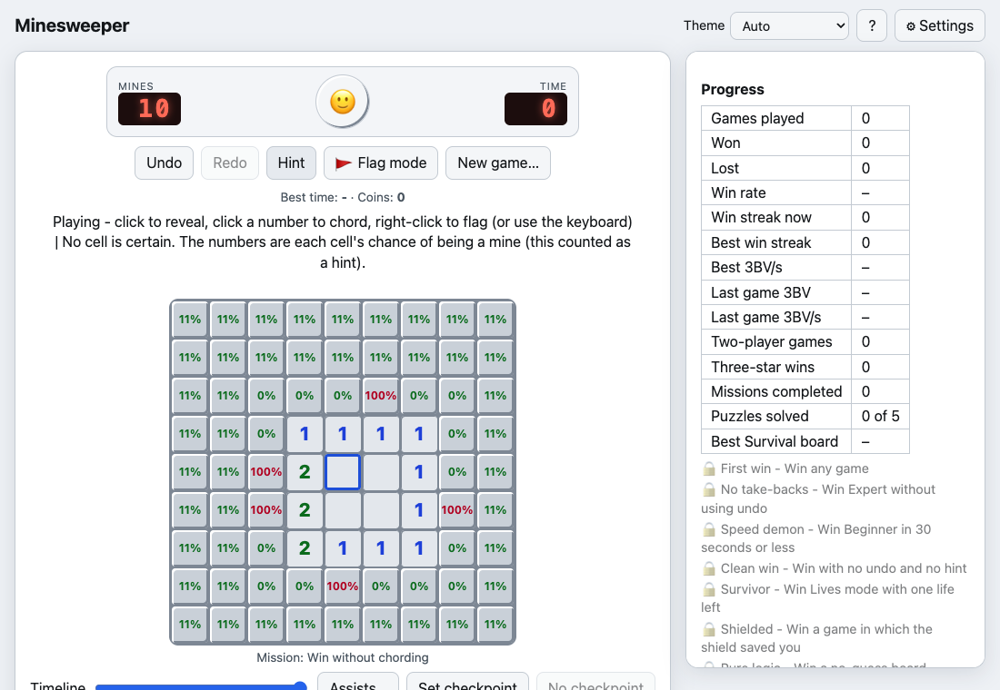

Probability hint: when nothing is certain, Hint shows every hidden cell's chance of a mine (0 percent and 100 percent cells are certain).

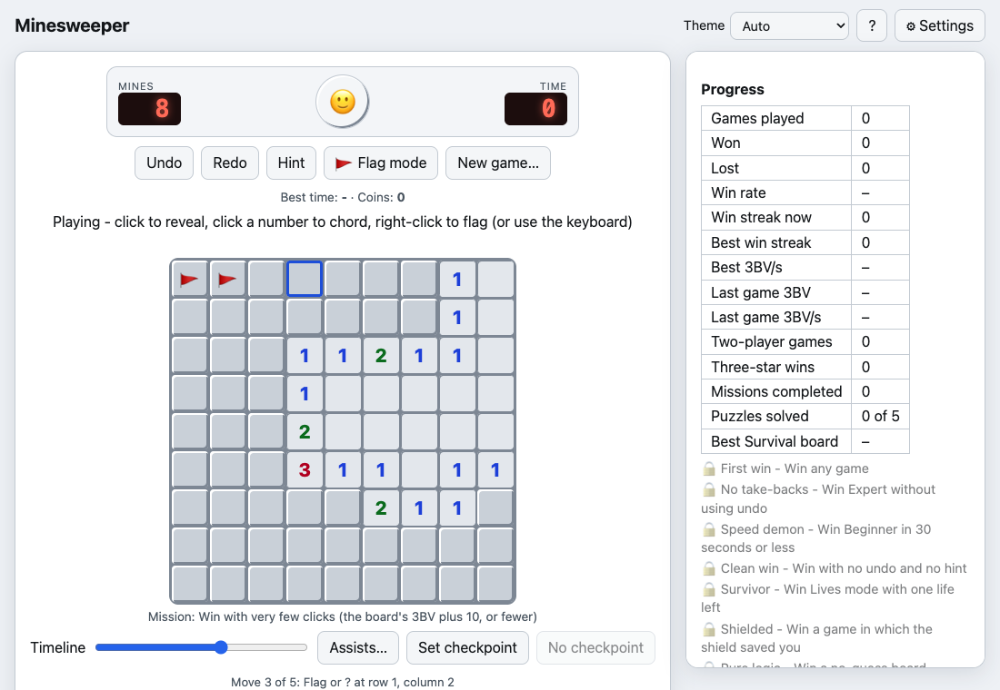

The undo timeline under the board: the slider jumps to any move; the label says which move it is. Checkpoints sit beside it.

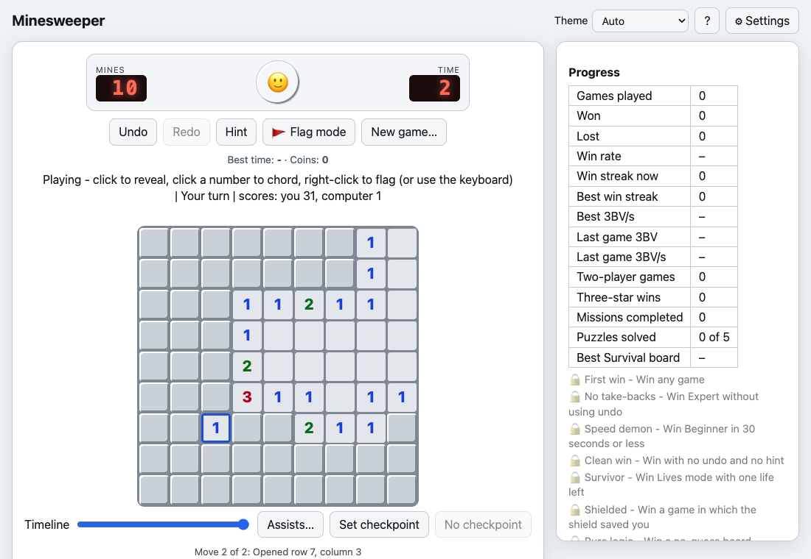

Versus the computer: the scores are in the status line, and the computer answers your move on the next clock tick.

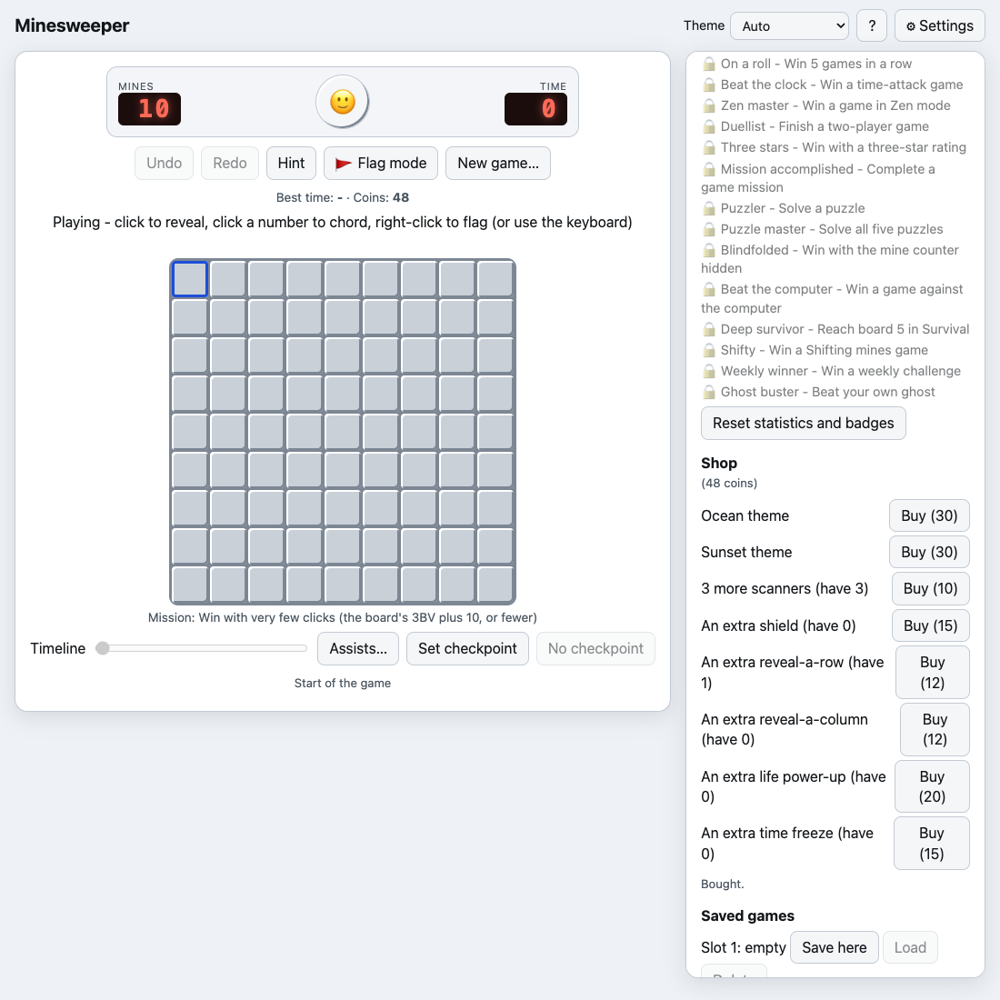

The shop in the Stats and saves panel: coins from wins buy themes and power-ups.

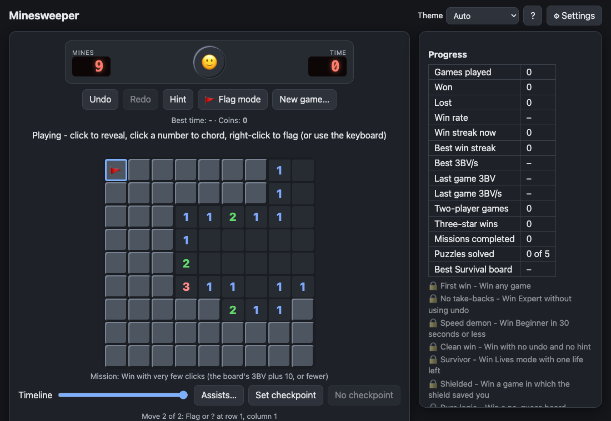

The dark theme. The Auto theme picks it when the device prefers dark.

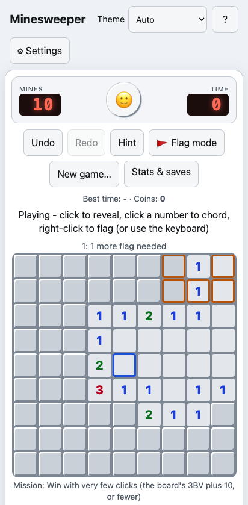

On a phone the layout is one column, buttons are at least 44 px tall, and the statistics panel becomes a bottom sheet.

## 2. Game overview and rules

- Objective: open every cell that has no mine, without opening a mine.
- Board: Beginner 9x9 with 10 mines (the default), Intermediate 16x16 with 40, Expert 16x30 with 99, or a custom size (5 to 30 rows, 5 to 40 columns, up to cells minus 9 mines). Three shapes: square, hexagonal (6 neighbours) and wrap-around (the edges connect).
- Mine placement: mines are placed on the first click, never on that cell or its neighbours, so the first move is always safe and always opens an area. Every game has a seed; the cells are shuffled with it and the mines are the first ones outside the safe zone, so one seed gives (almost) one board whatever the first click is. That is what makes share links and the daily challenge possible.
- Clues: an open number is the count of mines among its neighbours.
- Flags: right-click cycles hidden, flag, question mark, hidden. A question mark is not a flag and does not change the mine counter. Clicking an open number whose flags are all placed (chording) opens its other neighbours.
- Win: all safe cells are open (the mines are then flagged). Loss: a mine is opened (in Lives mode, the third one), or the clock runs out in Time attack.
- Undo and redo: undo restores the exact earlier state. Redo re-applies undone moves; a new move clears redo.
- Flood-fill as one move: opening a zero cell opens its neighbours, and so on. The memento is taken once, before the click, so the whole cascade is a single undo step.
- Undoing the first move: the memento was taken before the mines were placed, so undo returns to an empty board. The next first click lays the mines out again from the same seed.

Assumptions:
- Undo restores the full state (cells, flags, question marks, lives, scanner and shield charges, scores, whose turn it is, the status). It does not restore the clock, the number of hints used or the undo counter, because those describe the player, not the board.
- Clicks that change nothing (an open or flagged cell, a finished game) are not moves and are not recorded.
- Best times count only comparable games: classic mode, square board, no power-ups, no hints, not a custom size.

Extra features, all built on the same model: power-ups (a scanner that counts mines in a 3x3 area and a shield that survives one mine), hints, hover help on numbers, dimmed finished numbers, Lives / Limited undo / Undo costs 10 s / Time attack / Zen / Two players modes, no-guess boards, a daily challenge and share links, statistics with 3BV and 3BV/s, 24 achievement badges, replay, five themes (two from the shop), keyboard play with rebindable keys, saved-game slots, and download and upload of settings and games.

Smarter help, built on the solver (src/solver.js):
- Probability hint: when no move is certain, Hint shows every hidden cell's mine chance in percent (exact, from the frontier and the total mine count). Best guess highlights the lowest-chance cell. Both count as hints.
- Auto-flag flags every mine the logic proves, as one undoable move. It counts as a hint. Wrong-flag check marks flags on safe cells with a cross; it works once per game and costs 15 seconds.
- Hints, best guess and auto-flag are disabled in Puzzle and Hidden counter modes. A game that used any help is not a best-time record.

Undo-based play:
- Undo timeline: a slider over all moves jumps to any earlier or later state (each step is an undo or redo, so Limited undo and Undo costs 10 s still apply). Checkpoints remember a moment; returning counts as one undo.
- Earned undos: in Limited undo, one more undo for every 20 safe cells opened (the earned count is not part of the memento, so undo cannot farm it).

Modes added: Versus the computer (the solver plays: provably safe cells first, otherwise the lowest-chance guess), Survival (clearing a board starts a bigger, denser one and lives carry over), Puzzle (five fixed boards with a move limit), Hidden counter (no mine counter, no hints) and Shifting mines (every 5 moves one unflagged mine moves; undo and replay restore it exactly).

Power-ups and progression: reveal a row, reveal a column, extra life (lives modes) and time freeze (timed modes), on top of scanner and shield. Coins are earned from wins (more for stars, level, challenge and mission) and spent in a shop on power-ups for the next games and on two themes (Ocean, Sunset). Stars (1 to 3) come from time per 3BV unit.

Goals: a mission is picked for each game (for example win without flags, or without chording) and rewards coins; the weekly challenge is a fixed seed, mode and board shape for the ISO week; a ghost race replays your best win of the same board next to you and shows who is ahead.

## 3. Architecture

The project follows MVVM: the Game is the model, the ViewModel sits between the model and the view, and the view (index.html with app.js) only draws and forwards input. The Game and ViewModel contain no DOM code, so all of their logic is tested in plain Node with no browser.

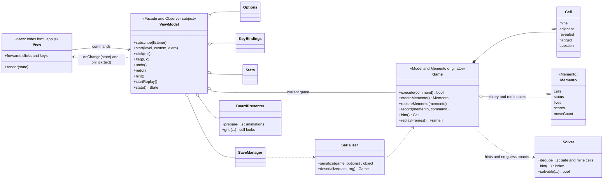

Files in src/:

| File | Responsibility |
|---|---|
| game.js | The model: cells, seeded mines, reveal and flood-fill, undo and redo, lives, power-ups, two players, hints, 3BV, replay frames |
| commands.js | The moves as Command objects (reveal, chord, mark, scan) |
| topology.js | Board shapes as Strategy objects (square, hex, torus) |
| solver.js | The logic solver used for hints and no-guess boards |
| serializer.js | Game to JSON and back, with validation |
| rng.js | Seeded random numbers, the daily seed, share-link parsing |
| levels.js | Difficulty levels and custom sizes |
| modes.js | The seven game modes as Strategy objects |
| options.js | The options (what they are, which values are allowed, saving) |
| keybindings.js | Keyboard shortcuts and rebinding |
| stats.js | Statistics, badges and the best-times table |
| savemanager.js | Autosave, slots and game files |
| presenter.js | What each cell looks like and which cells animate |
| ai.js | The computer opponent (safe cell by logic, else the lowest-chance guess) |
| puzzles.js | The five fixed puzzle boards |
| challenges.js | Missions and the weekly challenge rule |
| shop.js | Coins, shop items and owned themes |
| ghosts.js | Best wins kept for ghost races |
| viewmodel.js | The facade: the session, the clock, replay, tips, state() |
| app.js, a11y.js, sound.js, settingsfile.js | The view and its helpers (DOM code) |

## 4. Design patterns

| Pattern | Role in this project | Where |
|---|---|---|
| Memento | Undo and redo. Before each move the Game takes a memento (a deep copy of everything that can change). The history and redo stacks hold them, and undo restores one. | game.js: createMemento, restoreMemento, record, undo, redo, history, redoStack |
| Command | Every move is an object that knows how to execute itself and how to write itself down. The game keeps the commands it ran, so a replay is running the same commands again on a fresh board, and a saved game stores them as triples. | commands.js; Game.execute; Game.replayFrames; serializer.js |
| Observer | The ViewModel is the subject. A view calls subscribe with a listener; every change calls onChange(state) and every clock second calls onTick(text). Several listeners can be attached and removed independently. | viewmodel.js: subscribe, _notify, _notifyTick; app.js passes onChange and onTick |
| Strategy (board shape) | Which cells touch a cell is a strategy object. Numbers, flood-fill, chording, the solver and the hex layout all work through it, so a new shape is one new object. | topology.js; Game.nb; solver.js |
| Strategy (game mode) | Everything that differs between modes (how the Game is configured, the clock, the undo cost, the status text, whether wins are recorded) is one small class per mode. The ViewModel asks the current mode instead of testing the mode name. | modes.js; ViewModel.mode |
| Facade | The ViewModel gives the view one small interface and hides Options, KeyBindings, Stats, SaveManager, BoardPresenter and the modes behind it. | viewmodel.js |
| MVVM | Model (Game), ViewModel (state() and commands), view (app.js). The ViewModel builds a plain state object, including what every cell shows, so the view contains no game logic. | all of src/ |

Notes on the patterns:
- Memento. The Game is the originator, the history and redo stacks are the caretaker, and the memento is a plain object. A memento is used up when it is restored (undo pops it), so a restored memento must not be reused.
- Command. A command returns false when the move is not allowed and then records nothing, which is why a click on a flagged cell is not an undoable move. Commands use the Game's primitives (createMemento, record, openCell, endMove) rather than reaching into its fields.
- Observer. The constructor options onChange and onTick are simply the first subscriber. The tests subscribe extra listeners and unsubscribe them.
- Strategy. A Game stores only the topology name; the neighbour lists are built once from the strategy. A game mode is chosen when a game starts and is saved with the game, so a loaded game behaves the same way.
- Considered and not used: a State pattern for playing / won / lost / timeout (a status string and one method that ends the game are simpler here), and a Singleton (everything is passed in, which keeps the tests simple).

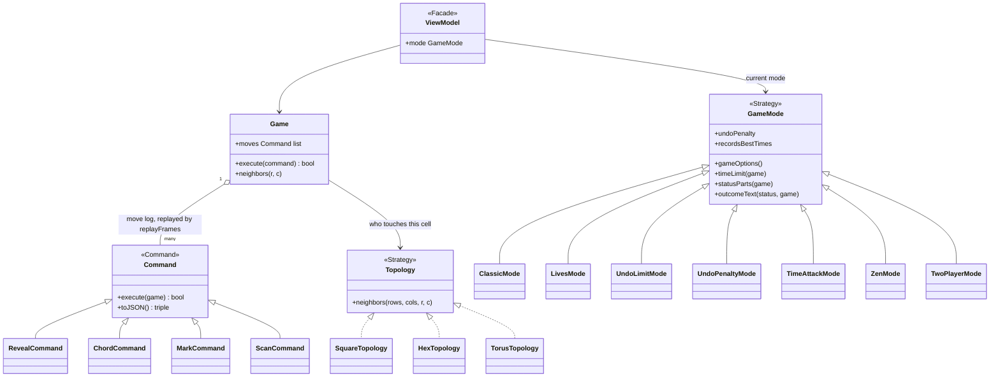

## 5. Implementation notes

- Seeds. A game stores one integer seed. Layout = shuffle all cells with a small seeded generator, then take the first mines that are outside the safe zone around the first click. Share links ("9x9x10-square-12345") and the daily challenge (a seed from the UTC date) reproduce boards this way.
- The solver. It only uses what the player can see. Rules: a number with no mines left makes its neighbours safe; a number whose hidden neighbours equal its remaining mines makes them all mines; the subset rule settles patterns such as 1-2-1; the global mine count settles hidden cells outside every number; and when at most 16 hidden cells are left, an exhaustive search of every placement that fits the numbers and the total settles the rest. The same solver gives hints and builds no-guess boards, so a no-guess board can always be finished with hints. On 300 seeded boards the logic-only player finishes 90.7 percent of Beginner, 63 percent of Intermediate and 8 percent of Expert boards (83, 56 and 5 percent before the two global rules were added). A hint was never on a mine in any of the test runs.
- Saving. A board is one character per cell, so a game with a long undo history stays small. The autosave keeps only the newest 100 undo steps (the replay log is kept whole), so its size is bounded. Slots and downloaded files keep the whole history. Loaded data is untrusted: sizes, characters, every number against its neighbours, mine counts, statuses and counters are all checked, and a game file never records a best time.
- Screens and accessibility. Every cell has a label ("Row 3, column 4, flagged"), the board is a grid with arrow-key navigation, the status line is a polite live region, and there is a visible focus ring. The colour contrast of every theme is checked by a test. Animations turn off with prefers-reduced-motion.
- Updates. The board's cells are created once and only the cells that changed are touched; the ViewModel hands back the identical cell object for an unchanged cell.

## 6. Testing

Logic tests (Node's built-in runner, no install):

    node --test

There are 192 tests. They cover mine placement, numbers, flagging, flood-fill, win and loss, and undo of the first move, a large flood-fill, a flag, with an empty history, after a loss and after a win; redo; chording; all game modes; hex and wrap-around boards; seeds; hints (never on a mine over many random boards on every shape, with power-ups); no-guess boards finished by hints alone; the solver rules on small hand-made boards; 3BV; replay frames; saving, loading and many kinds of tampered data; the autosave cap; the pattern classes one by one (topology, commands, mementos, modes, options, key bindings, stats, save manager, the observer); the exact probabilities (checked against brute force), assists, power-up commands, earned undos, shifting mines with undo and replay, the computer opponent, survival, puzzles (each one is checked to be solvable by local logic inside its move limit), hidden counter, timeline and checkpoints, shop and coins, stars, missions, the weekly challenge, ghost races, and the colour contrast of every theme.

Browser tests (optional, Playwright):

    npm install
    npx playwright install
    npm run test:e2e

61 checks run in five projects: desktop Chrome, Firefox, Safari (WebKit), an Android phone and an iPhone. They drive the real page: safe first click and flood-fill, flags, undo and redo, loss and win, chording, keyboard play, key rebinding, saved settings, saved games and slots, the best-times table, hints, modes, hex and wrap-around boards, replay, the daily challenge, share links, themes, accessibility labels and focus, and the layout on a phone. Pages are opened with a seed so the test knows where the mines are. Deliberate bugs in the chord rule, the hex and wrap-around neighbour rules, number dimming, board rebuilding, reduced motion and arrow-key focus each made the matching test fail, then the code was restored.

Results: 192 of 192 logic tests pass. The browser tests pass in Chrome, WebKit, the Android phone and the iPhone profiles. Firefox is configured but was not run: it would not start inside the development sandbox, so its results are unknown.

## 7. Limitations

- Sound has no automated test and was never listened to. The phone results come from emulated devices, not a real phone.
- On a phone the toolbar wraps onto several rows, so the board starts lower than on a desktop, and Expert scrolls sideways inside its card.
- Boards that need a real guess cannot be finished by logic, so no-guess hints end there; the probability hint then shows the best odds, but it is still a guess. Very large frontiers stop the exact count at a node limit and show no percentages. Only about 8 percent of random Expert boards are fully solvable by logic.
- Two players share one screen (hot-seat); there is no network play. The computer opponent is the same solver, so it is a fair but not human-like player.
- The five puzzles were picked by a program from generated boards and checked to be solvable by local logic within their move limit; they are not hand-designed. Checkpoints live in memory and are lost on reload.
- No-guess boards are built after the first click, so they cannot be shared as links or used for the daily challenge.
- The autosave keeps the newest 100 undo steps only; a resumed very long game cannot undo further back.

## 8. Demo script

1. Open index.html (or the GitHub Pages address). Point out the header (mines, face, time), the toolbar and the first-time tip.
2. Safe first click: click the middle. An area opens (flood-fill). Press Undo: the board is empty again (undoing the first move). Press Redo: the same area comes back.
3. Flagging: right-click a hidden cell for a flag (the counter drops), right-click again for a question mark, again to clear. Undo a flag. Turn on Flag mode to show the phone-friendly way.
4. Hint: press Hint (or H). A green outline marks a cell that is certainly safe. Open it. Repeat once or twice to show the logic.
5. Chording: flag all mines around a number (hover the number to see how many flags it needs), then click the number.
6. Win: keep using hints (or start a No-guess board from New game... and follow the hints) until every safe cell is open. The overlay shows time and best time. Press Undo to show undo after a win.
7. Loss: start a new game, make a safe click, flag one wrong cell, then click a mine. Show the outlined mine, the cross on the wrong flag and the dimmed rest. Press Undo in the overlay to take it back.
8. Lives mode: New game..., Mode Lives, Start new game. Open a mine: a heart is lost and the game continues. Undo gives the heart back.
9. Hex board: New game..., Board Hexagonal, Start new game. Click the middle: the numbers now count six neighbours.
10. Replay: finish a game (a quick loss is fine), then press Replay. Step forward and back, then press Play for the automatic replay, then Close replay.
11. Daily challenge: New game..., Today's daily challenge. The status line shows the date. Open the share link from the side panel in another tab: the same board appears.
12. Appearance and keys: switch the theme to Dark; open Settings, Controls and add a second key to Flag; press the ? button for the shortcut list.
13. Probability hint: start a new game and play until Hint says that no cell is certain. The numbers on the board are each cell's chance of a mine. Open Assists... and press Best guess: the safest cell is outlined.
14. Versus computer: New game..., Mode Versus the computer. Make a move; on the next clock tick the computer plays a safe cell or its best guess. Compare the scores in the status line.
15. Undo timeline: flag a few cells, then drag the Timeline slider back and forward. Set checkpoint, play on, press Back to checkpoint.
16. Survival and puzzles: Mode Survival, clear the board and see a bigger one start with the same lives. Then Mode Puzzle, pick a puzzle and solve it within the move limit.
17. Shop and missions: win a game (the mission line is under the board) to earn coins, open Stats and saves, buy a theme or a power-up, and choose the theme in the header.
18. Ghost race and weekly challenge: after a win press Race my best to play the same board next to a ghost of your win. Then New game..., This week's challenge for this week's fixed board and mode.
19. Tests: run node --test in a terminal and show the passing count.

## 9. Git workflow

The project was built in small steps, each a real commit made when that step worked and its tests passed (no backdated or artificial commits). The full list is in git log --oneline --reverse; the stages were:

| Stage | Commits | What they added |
|---|---|---|
| Setup and first version | 6ed0212, f7b88c8, 4f0af94, 4b3a335, d46f977 | Project setup; the Game with snapshot undo; the browser GUI; the first tests; the first report |
| First features | 5997e86, c1663d8, 4ce596d, 9e0e2ba, 18e3721 | Redo, difficulty presets, timer, best times; chording, custom size and the MVVM split; keyboard play and sound; saved mute and volume; rebindable keys |
| Framework experiments | cefb26a, df42c87, 0ea5c44, a74fc9a | A Vue view, then a React view driven by the same ViewModel; settings and game files; saved-game slots; Playwright tests |
| Large feature rounds | 3d108f2, 38ce4dc | Question marks, power-ups, hints, modes, hex and wrap-around boards, daily challenge, replay, themes; then the interface redesign with accessibility |
| Back to plain scripts | 6916121 | Removed Vue, React and the build step because the assignment is plain HTML, CSS and JavaScript |
| Patterns and documents | 4dd5248 | Command, Strategy, Memento and Observer made explicit; the ViewModel split into small classes; the stronger solver; the autosave cap; this report, the README and the GitHub Pages workflow |
| Workflows | cb49365 | The GitHub Actions workflows: newer action versions, Node 22, a pinned runner |
| Smarter help and progression | 3f5be76 | Probability hints, best guess, auto-flag, undo timeline and checkpoints, five new modes, more power-ups, coins and a shop, stars, missions, weekly challenge, ghost races |

The Vue and React views are still in the history: git checkout extras-vue-react-views shows them, and the commit message of 6916121 explains why they were removed.

## 10. Ideas not done

- Run the Firefox browser tests on a machine where Firefox can start.
- Test on a real phone, and bring the board higher up on small screens.
- Name the saved-game slots, and allow more than three.
